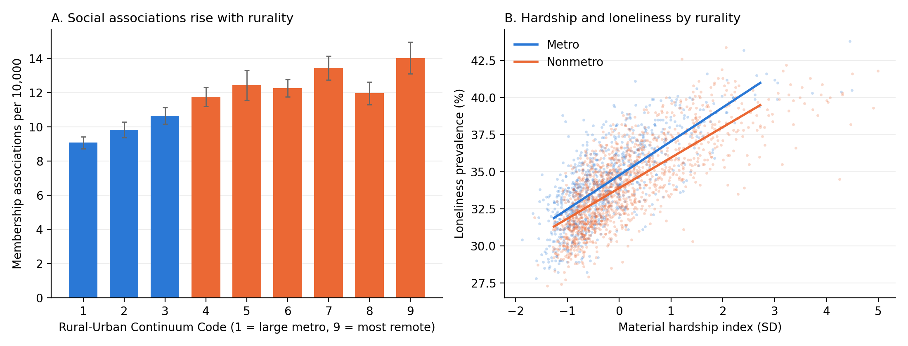

# Rural Strengths, Loneliness, and Cardiometabolic Health Across U.S. Counties

**Elizabeth Mollard**

Data and analysis code for a cross-sectional ecological study of rural community strengths. It
examines whether rural counties sustain social connection despite greater material hardship,
and how county loneliness relates to cardiometabolic health across the rural-urban continuum.

**Working manuscript title:** *Rural-Urban Differences in Material Hardship, Social Support, and
Loneliness Across U.S. Counties: Associations with Cardiometabolic Health.* A citation will be
added here on publication.



## Key findings

Sample: **2,289 counties in 38 states and the District of Columbia.** Loneliness and the other
social-needs measures are published only for states that administered the optional BRFSS
Social Determinants and Health Equity module.

- **More hardship without more loneliness.** Nonmetro counties had higher food insecurity
  (18.1% vs 15.9%), housing insecurity (14.4% vs 13.3%), utility insecurity (10.1% vs 8.9%)
  and transportation difficulty (9.9% vs 8.7%). Loneliness was statistically equivalent
  (34.16% vs 34.26%; difference 90% CI −0.29 to +0.11 points).
- **A rural loneliness advantage.** Accounting for hardship, nonmetro counties were
  0.65 points less lonely than metro counties (95% CI −0.94 to −0.36). Hardship was less
  strongly tied to loneliness in nonmetro counties (1.42 vs 1.64 points per SD; p = .03).
- **More civic infrastructure.** Membership associations per 10,000 rose from 9.1 in large
  metro counties to 14.0 in the most remote counties.
- **Loneliness and cardiometabolic health.** A 10-point rise in loneliness was associated
  with greater cardiometabolic burden in all nine rural-urban categories (0.30 z-units in large
  metro to 0.75 in the most remote; trend p = .004). The association persisted after adjusting
  for smoking, physical inactivity, obesity, sleep and binge drinking, which accounted for much
  of the stronger rural association.
- **Rural resilience.** Among high-hardship nonmetro counties, those with more social
  associations were more likely to have better-than-expected cardiometabolic health
  (OR 1.36 per SD; 95% CI 1.06–1.74).

All estimates are county-level (ecological) associations from cross-sectional data. They do
not show causation or individual-level effects.

## The dataset

[`data/analytic/county_analytic_dataset.csv`](data/analytic/county_analytic_dataset.csv) holds
one row per county in the analytic sample (2,289 × 32): rurality, social-needs measures,
cardiometabolic conditions, behavioral risk factors, socioeconomic covariates, social
associations, and the derived burden and hardship indices. Every variable is defined in
[`data/analytic/CODEBOOK.md`](data/analytic/CODEBOOK.md).

| Source | Content | Link |
|---|---|---|
| CDC PLACES, County Data, 2025 release (BRFSS 2023) | Social needs, cardiometabolic conditions, behaviors | [data.cdc.gov](https://data.cdc.gov/500-Cities-Places/PLACES-Local-Data-for-Better-Health-County-Data-20/swc5-untb) |
| USDA ERS Rural-Urban Continuum Codes, 2023 | Nine-category rurality | [ers.usda.gov](https://www.ers.usda.gov/data-products/rural-urban-continuum-codes) |
| USDA ERS County-Level Data Sets | Poverty (2023), education (2019–23), unemployment (2023) | [ers.usda.gov](https://www.ers.usda.gov/data-products/county-level-data-sets) |
| County Health Rankings & Roadmaps, 2025 | Social associations per 10,000 (County Business Patterns 2022) | [countyhealthrankings.org](https://www.countyhealthrankings.org/explore-health-rankings/rankings-data-documentation) |

## Reproducing the analysis

Requires Python 3.10+.

```bash
git clone https://github.com/<your-username>/rural-loneliness-cardiometabolic.git
cd rural-loneliness-cardiometabolic
python -m venv .venv && source .venv/bin/activate   # Windows: .venv\Scripts\activate
pip install -r requirements.txt
make all        # download sources, then run every analysis step
```

If an automatic download fails, save the file by hand as described in
[`data/README.md`](data/README.md), then run `make analysis`. Without `make`, run the scripts in
`src/` in numeric order from inside `src/`.

| Step | Script | Output |
|---|---|---|
| 1 | `01_download.py` | `data/raw/` source files |
| 2 | `02_build_analytic.py` | merged county file; `output/tables/sample_flow.csv` |
| 3 | `03_descriptives.py` | `table1_metro_nonmetro.csv`, `table2_by_rucc.csv` |
| 4 | `04_models.py` | loneliness × rurality models: `simple_slopes.csv`, `sensitivity.csv`, `figures/simple_slopes.png` |
| 5 | `05_strengths.py` | asset gradient, loneliness advantage, decoupling, buffering tests, positive deviance: `output/strengths_summary.md`, `figures/strengths.png` |
| 6 | `06_behavior_adjustment.py` | loneliness slopes after behavioral adjustment: `output/behavior_adjustment.md` |
| 7 | `07_export_data.py` | `data/analytic/county_analytic_dataset.csv` and `CODEBOOK.md` |

### Methods in brief

- **Cardiometabolic burden:** mean of the z-scores of age-adjusted hypertension, diabetes,
  coronary heart disease and stroke prevalence (Cronbach's α = 0.97).
- **Primary model:** `burden ~ (loneliness/10) × RUCC(1–9) + poverty + education +
  unemployment + Census region`, ordinary least squares with standard errors clustered by
  state, because PLACES estimates share state-level random effects. Loneliness slopes within
  each rurality category are linear combinations of the main effect and interaction terms.
- **Rural-urban comparisons:** unweighted county means of age-adjusted prevalence, with
  Welch t-tests and an equivalence test for loneliness (±1 point).
- **Sensitivity analyses:** robust (HC3) SEs, state fixed effects, population weights,
  adjustment for lack of social support, crude prevalence, each condition as a separate
  outcome, and sequential behavioral adjustment.

Every analytic choice is a named setting in [`src/config.py`](src/config.py).

### Testing without the real data

```bash
python tests/make_synthetic_data.py && make analysis
```

This writes random data in the same file layouts to check that the pipeline runs. Delete
`data/raw/` and re-download before producing real results.

## Repository layout

```
├── data/
│   ├── analytic/       shareable county dataset + codebook (committed)
│   ├── raw/            downloaded source files (not committed)
│   └── processed/      intermediate merged file (not committed)
├── output/             tables, figures and result summaries
├── src/                pipeline scripts and config.py
├── tests/              synthetic-data generator
├── Makefile
└── requirements.txt
```

## Data availability statement

> The county-level analytic dataset and all analysis code are publicly available at
> https://github.com/<your-username>/rural-loneliness-cardiometabolic. The dataset was
> constructed from publicly available sources: CDC PLACES (2025 release), USDA Economic
> Research Service Rural-Urban Continuum Codes (2023) and County-Level Data Sets, and County
> Health Rankings & Roadmaps (2025).

## Citation

See [`CITATION.cff`](CITATION.cff). When using the data, please also cite CDC PLACES, USDA ERS
and County Health Rankings & Roadmaps (full citations in the codebook).

## License

Code: MIT (see [`LICENSE`](LICENSE)). The dataset combines public data from U.S. government
agencies and County Health Rankings & Roadmaps; reuse it with attribution to those sources.
